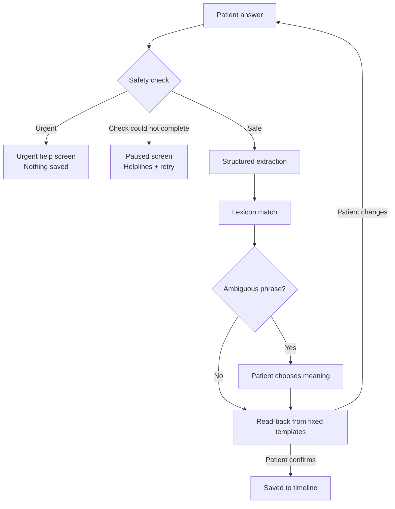

# Treatment Timeline

> **Prototype only. Do not use with real patient data.**
> This project is a research and demonstration prototype. It uses synthetic data only. It is not a medical device, it has not been clinically validated, and it must not be used to make decisions about anyone's care.

Treatment Timeline is a patient-held tool for recording a mental health medication history in the patient's own words. A patient describes each medicine they have taken, in Hindi, English or a mix of both (Hinglish). The tool turns those answers into a structured timeline that a clinician can read in minutes, and it keeps the patient's original words beside every interpretation.

---

## Contents

- [The problem](#the-problem)
- [Who this is for](#who-this-is-for)
- [What the tool does and does not do](#what-the-tool-does-and-does-not-do)
- [How it works](#how-it-works)
- [Safety design](#safety-design)
- [Data and privacy](#data-and-privacy)
- [Evaluation](#evaluation)
- [Getting started](#getting-started)
- [Scripts](#scripts)
- [Project structure](#project-structure)
- [Known limitations and open questions](#known-limitations-and-open-questions)
- [Roadmap](#roadmap)
- [Sources](#sources)

---

## The problem

The tool sits where three documented problems meet.

**1. Medication histories are poorly recorded.**
Doctors need to know which medicines a patient has tried, at what dose and for how long, before they can judge what to try next. Routine records often lack this detail. King's College London built the Maudsley Treatment Inventory because routine records often do not show whether a past treatment had an adequate dose and duration. Patients who have seen several doctors over several years carry most of this history in their memory, and a short appointment is a poor place to reconstruct it.

**2. Many South Asian patients describe distress in ways that standard tools miss.**
A 2026 systematic scoping review led by the University of Surrey, published in *The British Journal of Psychiatry*, found that physical pain, heart-related sensations and repetitive negative thinking are among the most commonly reported depression symptoms in South Asian communities, but none of them appear in the diagnostic criteria used for screening in UK primary care. Phrases such as *"dil ghabrata hai"* or *"ghabrahat"* can mean anxiety, restlessness or a racing heart, depending on the person and the context.

**3. Language barriers damage history-taking.**
Studies of interpreted clinical visits, mainly from the United States and mainly with Spanish speakers, report frequent interpretation errors, including omitted questions about medicines and past history. Errors with possible clinical consequences are more common when family members or untrained staff interpret. Whether these findings transfer to South Asian languages is an assumption, not a measured fact.

Current AI models do not solve this on their own. A 2025 study found that language models fail to represent idioms of distress in Indic languages reliably.

**The gap this prototype explores:** a patient-held history, built in the patient's own language, that preserves their words and shows a clinician exactly what is known, what is uncertain and what is missing. No study has yet measured this combined gap directly. Testing whether it is real is part of the purpose of this prototype.

---

## Who this is for

**Primary users: patients**
- Adults who have taken one or more mental health medicines, especially people who have seen several clinicians over time.
- People who are more comfortable describing how they feel in Hindi or Hinglish than in clinical English.
- Patients who want to arrive at an appointment with their history organised, instead of reconstructing it from memory under time pressure.

**Secondary users: clinicians**
- Psychiatrists, GPs and mental health practitioners who need a fast, structured view of a patient's past treatments.
- Clinicians who do not share the patient's language, and who benefit from seeing both the patient's words and a plain interpretation.

**Research audience**
- Researchers working on culturally grounded mental health assessment, multilingual NLP, or treatment history methods.
- Teams interested in how AI tools can stay honest about uncertainty in clinical records.

**Not for**
- Crisis support. The tool detects urgent statements and directs people to emergency and crisis services, but it is not a support service.
- Diagnosis, treatment recommendations, or judging whether a treatment trial was adequate.
- Any use with real patient data in its current form.

---

## What the tool does and does not do

| The tool does | The tool does not |
| --- | --- |
| Record each medicine, dose, start and stop dates | Diagnose any condition |
| Ask four plain questions per medicine, in Hindi and English | Judge whether a treatment worked "well enough" |
| Accept answers in Hindi, English or Hinglish | Recommend or change any treatment |
| Ask the patient to choose a meaning when a phrase is ambiguous | Guess a meaning the patient has not confirmed |
| Separate "you don't remember" from "not discussed yet" | Fill missing information with assumptions |
| Read back exactly what will be saved, and wait for confirmation | Save anything before the patient confirms it |
| Stop and show helplines when an answer suggests urgent risk | Replace crisis services or clinical care |

The tool is designed as a **record**, not a decision tool. Clinical judgement stays with the clinician.

---

## How it works

### The patient's journey

1. **Add a medicine.** The patient enters the medicine name, dose, start month and stop month. Every field accepts "I don't know", and "I'm not sure" lets them enter more than one possible value (for example "50 or 100 mg").
2. **Answer four questions,** one per screen:
   - How did taking this medicine fit into your routine?
   - Did it help, and if so, how?
   - Did you notice any side effects or new problems?
   - Why did you stop, if you did?
3. **Confirm meanings.** If an answer contains a phrase with more than one possible meaning, the tool shows the patient's exact words and offers plain-language options to choose from.
4. **Check the read-back.** The tool shows what it understood, in the patient's chosen language. The patient confirms it or changes it.
5. **See the timeline.** Each medicine becomes a card with the facts, the patient's own words, the confirmed meanings, and a list of gaps.

### What happens to each answer



1. **Safety check first.** Two independent checks run on every answer before anything else happens (see [Safety design](#safety-design)).
2. **Structured extraction.** A safe answer goes to a language model, which fills a fixed structure. Each field has one of four states:

   | State | Meaning |
   | --- | --- |
   | `known` | The patient stated a value |
   | `uncertain` | The patient gave possible values (stored as options) |
   | `unknown` | The patient said they do not know or remember |
   | `not_mentioned` | The answer did not address this field |

   The fields are: dose, duration taken, time to onset after starting, adherence, effect, side effects, reason for stopping, who decided to stop, dose timing and symptom timing. The model is instructed not to infer anything the patient did not say. For example, it must not infer whether a medicine helped from its side effects.
3. **Lexicon match.** Expressions of distress and side effects are matched against a lexicon of Hindi and Hinglish phrases. Each entry lists candidate meanings in plain English and plain Hindi, plus clinical terms for the clinician view.
4. **Read-back.** The summary is built by code from fixed sentence templates in Hindi and English. It is never written freely by the language model, so the patient confirms exactly what will be stored.
5. **Save.** Nothing reaches the timeline until the patient presses "Yes, this is right".

---

## Safety design

Safety is the part of the system that matters most, and it has the strictest rules.

**Two independent checks**
- **Keyword check.** A list of urgent phrases in English, Hinglish and Devanagari Hindi, covering self-harm, suicide, overdose and severe physical reactions. A normalisation step runs first, so spelling variants match (for example *nahi*, *nahin* and *nhi*). Matching uses whole words only, so "spend it all" never matches "end it all".
- **Classifier check.** A language model reads each answer for urgent meaning, including indirect statements that contain no keyword.

If **either** check finds urgent content, the answer is treated as urgent.

**What the patient sees**
- **Urgent help screen.** The interview stops and nothing from that answer is saved. The screen changes with the type of risk:
  - For a severe physical reaction, it says this may be a medical emergency and shows 999 (UK) and 112 (India) first and largest.
  - For self-harm or suicide risk, it shows emergency numbers plus NHS 111 (option 2 for mental health), Samaritans (116 123) and Tele-MANAS (14416).
  - The only button is "I am safe – go back to home". There is no way to continue the interview from this screen.
- **Paused screen (fail-safe).** If the classifier cannot give an answer (for example a timeout or an invalid response), the answer is never treated as safe and never sent to extraction. The interview pauses, shows helplines and offers a retry. The keyword check still runs in this case.

**Other safeguards**
- A rate-limit error or timeout is a technical failure, never a safety result.
- Every trigger and fail-safe event is logged. By default the log stores only metadata (which check fired, matched keyword, label, time), not the patient's words.
- The safety logic runs on the server only. A build check confirms that no safety code, keyword list, prompt or API key reaches the browser.
- The urgent screen has no animation, and all motion respects the device's reduced-motion setting.

Helpline numbers live in one file, `src/config/safety-helplines.ts`. **Verify them before any real use.**

---

## Data and privacy

- **Synthetic data only.** The three seed patients and all test answers are invented.
- **Local only.** The app runs on your own machine with a local SQLite database. There is no hosting, no analytics and no third-party tracking.
- **Answer text in logs is off by default.** Set `DEV_LOG_TEXT=true` in `.env.local` only for local development with synthetic data. The log page shows clearly whether this setting is on.
- **API data terms.** Answers are sent to the Google Gemini API for the safety check and extraction. Check Google's current Gemini API terms for your region before sending any data. Do not send real patient information.
- **Secrets.** The API key lives only in `.env.local`, which Git ignores. Never commit it.

Before any use with real people, this project would need ethics approval, a data protection impact assessment, clinical review of the safety logic and lexicon, and a regulatory assessment.

---

## Evaluation

The project includes an evaluation harness that runs synthetic patient answers through the real pipeline and scores every field.

**Current test set: 26 fixtures**
- 15 safe answers in Hindi, English and Hinglish, including informal spelling, feminine verb forms, Devanagari mixed with English, partial memory and figurative speech.
- 9 urgent answers, including 3 indirect statements that contain no keyword and can only be caught by the classifier.
- 2 simulated classifier failures, to test the fail-safe.

**Current result:** all 26 pass, with every structured field scoring 100% on this set. The report also prints a confusion table for each field, accuracy on fields where a value was actually stated, every safety miss, and every false alarm.

**What this result means, and what it does not**
- It shows that the pipeline works end to end on these cases.
- It does **not** show that the safety check is reliable in general. The test set is small, and most of it was written with AI help. Harder cases are still to be added: past crises, statements about other people, very indirect phrasing, and figurative speech that sounds alarming.
- One answer is a known false alarm by design: "*Mujhe marne ke khayal kabhi nahi aaye*" (I never had thoughts of dying) triggers the keyword check because of the negated phrase. In this design, a false alarm is acceptable and a missed urgent statement is not.

The evaluation cache is keyed on the answer, the models, the prompts and the lexicon, so any change to a prompt or the lexicon forces fresh results.

---

## Getting started

### Prerequisites
- Node.js 20 or later
- A Google Gemini API key from [Google AI Studio](https://aistudio.google.com/apikey). Check in AI Studio that the configured models are available on your tier.

### Setup

```bash
npm install
```

Copy the example environment file and add your key:

```bash
# macOS / Linux
cp .env.example .env.local

# Windows PowerShell
Copy-Item .env.example .env.local
```

Open `.env.local` in a text editor and set `GEMINI_API_KEY`. Do not paste the key into any chat or shared document.

Create the local database and add the synthetic patients:

```bash
npx prisma generate
npm run db:push
npm run db:seed
```

Check the environment and start the app:

```bash
npm run check:env
npm run dev
```

Open [http://localhost:3000](http://localhost:3000).

### Configuration

All model and API settings are in `src/config/app-config.ts`:

| Setting | Value |
| --- | --- |
| Safety classifier model | `gemini-3.5-flash-lite`, temperature 0 |
| Extraction model | `gemini-3.5-flash`, temperature 0.1 |
| Minimum gap between API calls | 6 seconds (override with `GEMINI_MIN_GAP_MS`) |
| Request timeout | 30 seconds |
| Retries on rate-limit errors | 3, with exponential backoff |

---

## Scripts

| Command | What it does |
| --- | --- |
| `npm run dev` | Start the local development server |
| `npm run build` | Build the production version |
| `npm run check:env` | Check that the API key is set and the models respond (never prints the key) |
| `npm run db:push` | Create or update the local SQLite database |
| `npm run db:seed` | Add the three synthetic patients |
| `npm run test:normalise` | Run unit tests for keyword normalisation and whole-word matching |
| `npm run eval` | Run the evaluation harness (uses the cache) |
| `npm run eval -- --no-cache` | Run the evaluation with fresh API calls |
| `npm run eval -- --repeat 3` | Run the safety fixtures three times and report any result that changes |
| `npm run preview:readback` | Print Hindi and English read-back summaries for sample fixtures |
| `npm run check:client-bundle` | After a build, confirm no server, safety or API code reached the browser |

---

## Project structure

```
src/
  app/
    page.tsx                  Home and timeline screens
    interview/page.tsx        Add medicine, interview, meaning check, read-back,
                              urgent help and paused screens
    logs/page.tsx             Safety log (developer view)
    api/
      interview/analyze/      Safety check, then extraction
      medications/confirm/    Saves a confirmed medicine
      patients/               Synthetic patients and timelines
      logs/                   Safety trigger log
  components/ui/              Visual components, Hindi/English text, design shell
  config/
    app-config.ts             Models, timeouts, rate limits, logging switch
    safety-helplines.ts       UK and India helpline numbers
  lib/
    safety.ts                 Keyword check, normalisation, classifier, fail-safe
    extraction.ts             Structured extraction schema and prompt
    lexicon.ts                Phrase matching and meanings
    timeline.ts               Read-back templates, gaps, date formatting
    interview.ts              The four interview questions
    request-queue.ts          Rate limiting, timeouts and retries
data/
  lexicon.json                Hindi and Hinglish expressions with candidate meanings
prisma/
  schema.prisma               Local database schema
  seed.ts                     Three synthetic patients
scripts/                      Evaluation, environment, read-back and bundle checks
tests/
  fixtures/eval-fixtures.json Synthetic test answers with expected results
  normalise.test.ts           Unit tests for keyword matching
```

---

## Known limitations and open questions

- **Past crises.** Patients describing a past crisis currently trigger the urgent screen, the same as present risk. A design decision is pending: keep this, add a separate "past risk mentioned" level that continues the interview with helplines shown, or ask the patient whether it is happening now. Any change needs clinical review.
- **The lexicon is unvalidated.** Every meaning in `data/lexicon.json` is marked unvalidated. Bilingual clinicians and community members need to review it, and the lexicon will need many more entries.
- **The test set is small and partly AI-written.** See [Evaluation](#evaluation).
- **Language coverage.** Only Hindi, English and Hinglish are supported. Other South Asian languages are not.
- **Text input only.** Photo upload of prescriptions and voice input are not built yet.
- **Browser lexicon workaround.** A small shim lets browser code read the lexicon. A cleaner fix is to import the lexicon file directly in `src/lib/lexicon.ts`.
- **Regulation.** If the tool ever judged treatment adequacy or made clinical recommendations, it would likely count as a medical device. The current design avoids this by recording, not judging.

---

## Roadmap

- **Phase 1 (done):** safety check with fail-safe, request queue, structured extraction with four field states, lexicon and meaning check, bilingual read-back gate, evaluation harness.
- **Phase 2 (done):** visual design, category-specific urgent screens, accessibility and reduced-motion support, client bundle check.
- **Next:** harder safety fixtures, the past-crisis decision, native-speaker review of all Hindi text and lexicon meanings.
- **Later:** photo upload of prescriptions and letters, voice input in Hindi and English, a clinician review view with time-limited sharing, and carer input clearly labelled as separate from the patient's account.
- **Research:** test whether incomplete treatment histories are measurably worse for South Asian patients, and run usability sessions with synthetic scenarios.

---

## Sources

- King's College London. *Maudsley Treatment Inventory (MTI).* https://www.kcl.ac.uk/research/mti
- University of Surrey (2026). *Understanding depression symptom heterogeneity in South Asian minority groups: systematic scoping review.* The British Journal of Psychiatry. DOI: 10.1192/bjp.2026.10539. News release: https://www.surrey.ac.uk/news/standard-depression-screening-could-be-missing-key-symptoms-south-asian-patients-review-finds
- Flores, G. et al. (2003). *Errors in medical interpretation and their potential clinical consequences in pediatric encounters.* Pediatrics, 111(1), 6–14.
- *Lost without translation: Can transformer (language models) understand mood states?* (2025). arXiv:2512.00274. https://arxiv.org/abs/2512.00274
- Shivaprakash, P. et al. (2025). *Cross-Lingual Mental Health Ontologies for Indian Languages.* arXiv:2510.05387. https://arxiv.org/abs/2510.05387

---

## Author

Built by Shiwakshi as an independent research prototype at the intersection of research methodology and applied AI.

No licence has been chosen yet. All rights reserved.
